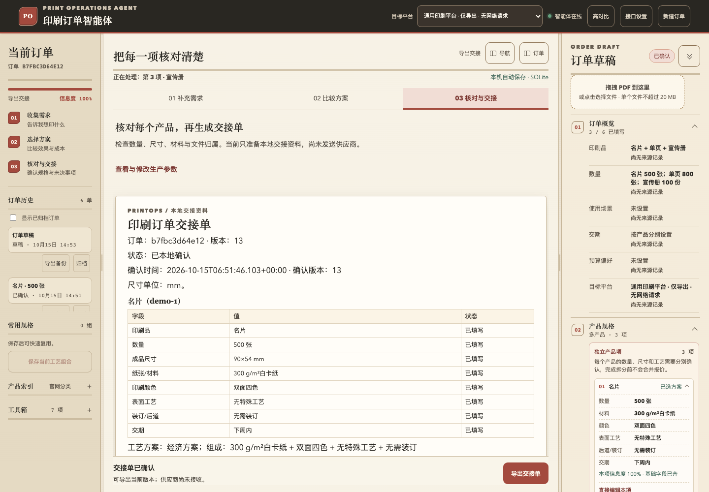
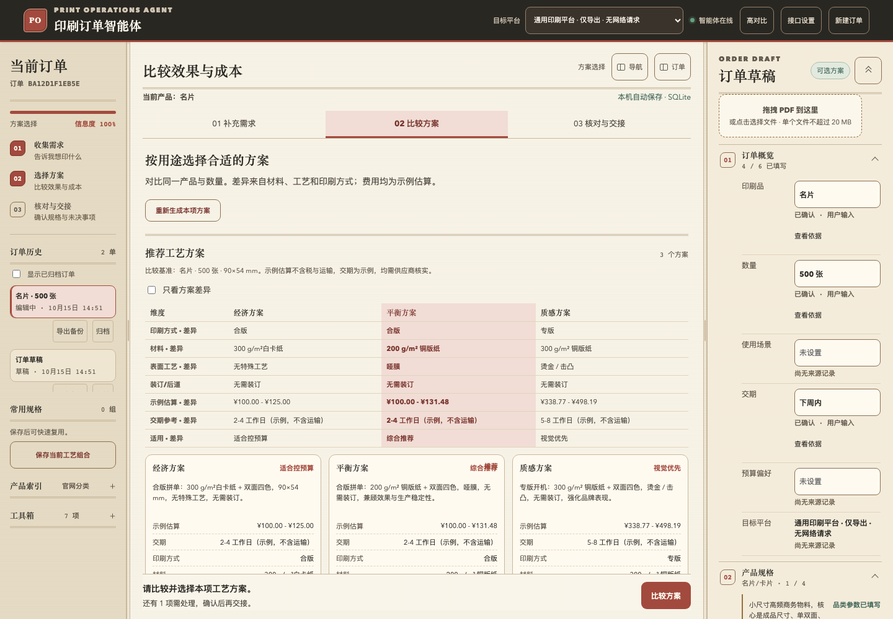
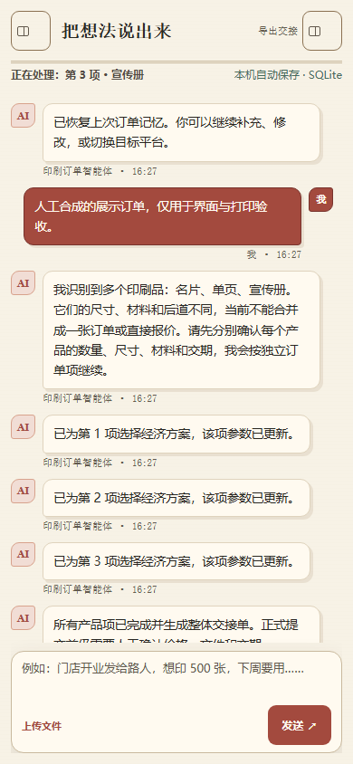

<div align="center">

# PrintOps Print Order Agent

**Turn a vague print requirement into a local handoff with reviewable specifications and traceable evidence**

[简体中文](README.md) · [English](README.en.md)

[](LICENSE)


**Python standard-library runtime · Local first · Optional models · Human review and confirmation**



</div>

## Who it helps

PrintOps helps marketing, design, and procurement users without print production expertise. Start with a purpose and approximate requirement, then supply the product, quantity, dimensions, material, colors, and deadline as prompted. Compare production options, inspect their evidence, and prepare a local handoff for supplier review.

**North star**: a first-time user independently completes an accurate handoff with reviewed production parameters and traceable evidence within 10 minutes. Timing starts with the first valid requirement and includes clarification, waiting, edits, confirmation, and export. Completion requires opening the exported file and checking that it matches the current confirmed order version. Filled fields or a generated draft are intermediate states.

The initial study assigns one primary task to each of 8 non-expert participants who did not develop the product: 3 business-card, 3 flyer, and 2 standard-brochure tasks. The target is at least 7 independently completed, qualified tasks within 10 minutes, with zero critical dimension/quantity errors, item mix-ups, or stale confirmations. All participants must understand that estimates are not supplier quotes and no order has been sent. **Human validation is still pending**; fixed tasks, grading rules, and blank records are in the [user walkthrough pack](docs/USER_WALKTHROUGH.md).

## Current capabilities and boundaries

- `VERSION` remains the **1.2.0 candidate baseline**, with unreleased work in the workspace. See the [implementation acceptance matrix](docs/IMPLEMENTATION_ACCEPTANCE.md). A code update does not establish a stable release.
- This is a pre-order preparation tool. There is no authorized live supplier connection, real HTTP transport, or live tool endpoint. Confirmation, export, and printing do not mean a supplier received anything.
- Reference estimates use versioned **illustrative parameters created by hand**, not market prices, supplier quotes, or promised lead times. PDF checks provide basic clues, not proof that a file is production-ready.
- The real desensitized corpus currently contains **0** orders, so the strict release gate remains blocked. Development fixtures, demos, usability tasks, and sample prices cannot replace real orders.
- Current domain rules and demonstrated inputs use Chinese. This English README does not establish tested English conversation support.

## Quick start

Running the product requires **Python 3.9+** and a browser. npm, Playwright, and third-party Python packages are not runtime dependencies.

```bash
git clone https://github.com/11122313211/PrintOps.git
cd PrintOps
python3 server.py --check
python3 server.py
```

On Windows, you can double-click `start_windows.bat` in the project directory. Open [http://localhost:4174/](http://localhost:4174/) after startup; the health endpoint is [http://localhost:4174/api/health](http://localhost:4174/api/health). **Do not double-click `index.html` or use `file://`**: the page needs the local API. No model configuration is needed for the rule-based mode.

The terminal displays a local access token, which the served page supplies automatically. curl requests need the `X-PrintOps-Token` header, except for health checks. Defaults are `PRINTOPS_STORE=sqlite` and `PRINTOPS_MEMORY_PATH=data/agent.sqlite3`. The `memory` backend is for temporary demos or tests; its data disappears when the process exits. See the [storage contract](docs/STORAGE_CONTRACT.md) for history, archive, and full backups.

| Startup issue | Next action |
| --- | --- |
| The address starts with `file://` | Start the service and use the HTTP address above. |
| Connection fails / health endpoint is unavailable | Check that the server process is running, inspect its terminal, and run `python3 server.py --check`. |
| Authentication fails after a restart | Reopen the served page to obtain the current process token; do not reuse an old token. |
| Port 4174 is occupied | Identify the listener first: `lsof -nP -iTCP:4174 -sTCP:LISTEN` on macOS/Linux; `Get-NetTCPConnection -LocalPort 4174 -State Listen` in PowerShell. |

## A complete use-case example

This is a **manually authored demonstration**. On 2026-10-15, an in-memory Agent without a model was used to verify the two inputs, option selection, draft generation, and local confirmation. This is not a human timing result or acceptance evidence for the new UI. UI entry points may change during development.

1. Enter the tested Chinese input: `门店开业要发给路人，约500张，下周要用。`
   It describes about 500 copies for a store-opening giveaway next week. The agent first asks which print product is wanted. Purpose does not replace production specifications, and approximate quantities need review.
2. Once the example user chooses a flyer, enter: `做单页，数量确定500张，成品210×297mm，157g铜版纸，双面四色，下周内，无特殊工艺。`
   The agent normalizes the values to 500 sheets, `210 × 297 mm` (A4), and `157 g/m²` coated paper, then offers three options. If unsure about a material, ask for an explanation or recommendation and review the selected parameters. This example is not a universal default specification.
3. Inspect differences and cost assumptions, then select the economy option (`经济方案`) for this example. Review the quantity, finished size, material, double-sided four-color printing, no special finishing, and no binding. Other options may change material or finishing and require another review.
4. Generate the handoff draft and inspect its fields and supplier questions. No file is available in this example. Record that the file is pending and price/deadline require supplier review, then explicitly confirm locally.
5. Export and open the file; check its contents, confirmation state, and version. After changing quantity, size, material, or option, regenerate and confirm again. The review view provides authoritative current-version JSON/CSV/Markdown exports and A4 printing; full history backups serve recovery and audit. See [development acceptance](docs/NEXT_STAGE_ACCEPTANCE.md).

### Handoff content example

This is an excerpt of the **local draft generated by the rule-based run**, showing specifications and boundaries, not a sent order. Actual identifiers, revision, and confirmation time come from the run record. Domain content remains Chinese:

```text
目标平台：通用印刷平台
供应商状态：仅本地草稿，生产能力、价格和交期需确认
印刷品：单页
数量：500 张
成品尺寸：210×297 mm
纸张/材料：157 g/m² 铜版纸
印刷颜色：双面四色
表面工艺：无特殊工艺
装订/后道：无需装订
交期：下周
```

The local confirmation note is `仅核对本地交接内容；文件待交付，价格与交期待供应商复核。` It acknowledges review of the local content while leaving the file, price, and deadline open for further work. It does not create a supplier commitment. Pending field candidates cannot be treated as approved production specifications in a handoff.

## Capability matrix

| Capability | Available now | Limits and evidence |
| --- | --- | --- |
| Product recognition and parameter intake | 17 catalog types, category questions, revisions/negations, independent product items | Catalog size does not imply complete pricing coverage. Accuracy on real customer language still needs a real corpus. |
| Dimensions and evidence | mm normalization; cm/in and ISO 216 aliases; separate finished/expanded/die-cut/unspecified-package/inner/outer dimensions | Original text and candidates are retained. Low-confidence production parameters require confirmation. See the [order contract](docs/ORDER_CONTRACT.md). |
| Conditional illustrative pricing | Business cards, flyers, digital printing, invitations; brochures/books, folded leaflets, and some packaging/labels/posters under category-specific conditions | Quantity units, material, sides, and pricing dimensions must be explicit. Folded leaflets need expanded size; books need pages/binding; box dimensions cannot replace a flat die-cut area. See [pricing coverage](docs/PRICING.md#当前覆盖范围). |
| Uncalibrated categories | Parameters can be collected for PVC/PVC cards, hang tags, multipart forms, envelopes, bags, and paper cups | Pricing is blocked rather than using a generic category price. Unknown processes return known costs and unpriced items without a full range. |
| Explainable estimates | Decimal costs for material, setup, printing, finishing, binding, die-cutting, packaging, and minimum-charge adjustments | `ready` gives a full illustrative range, `partial` a known subtotal, and `blocked` actionable reasons. Basis is tax-exclusive and ex-works; sources, versions, and exclusions are inspectable. |
| Basic file checks | Local browser PDF page count, page boxes, color-space and embedded-font clues; originals are not uploaded | Not professional prepress validation. An absent file must remain marked as pending. |
| Memory and recovery | Authoritative backend OrderStore; SQLite/memory/custom, CAS, full history, archive, and backup | SQLite is the built-in default. Memory is temporary; enterprise databases require trusted registered implementations. |
| Supplier connections | Generic local export, unconfigured suppliers, local mock, connector protocol and contract tests | No real supplier connection. Mock/sandbox results do not verify production capability. |
| Handoff and confirmation | Authoritative handoff, local confirmation, JSON/CSV/Markdown, A4 printing, separate full history backup | Confirmation is not an authenticated corporate signature; export is not transmission. Exports recheck the current version; edits invalidate prior confirmation. |

## Interface previews

These are historical Chromium screenshots from the **2026-10-15 uncommitted development workspace on the 1.2.0 candidate baseline**, using synthetic demonstration orders; the current UI-position tuning is represented by the live page and browser suites. The stages are intake, comparison, and review/handoff. The 390px image is a desktop narrow viewport, not real mobile/touch acceptance.

| Option comparison | 390px narrow viewport |
| --- | --- |
|  |  |

## Development and acceptance

This project intentionally does not use GitHub Actions; release checks run on the local machine. See [SECURITY.md](SECURITY.md) for vulnerability reporting and [CONTRIBUTING.md](CONTRIBUTING.md) for development constraints.

The Python runtime and unit/contract checks use the standard library. **Browser development tests additionally require Node.js 18+, npm, pinned Playwright, and Chromium**. These are not needed to start the product.

```bash
python3 tools/dev_check.py                             # one-command local gate: compile, tests, evaluation, guards
python3 -m unittest discover -s tests -p "test_*.py"
PYTHONPATH=. python3 tests/evaluate_agent.py             # Development report
PYTHONPATH=. python3 tests/evaluate_agent.py --release-gate --json
python3 tools/secret_scan.py
python3 tools/repo_guard.py
python3 tools/dsh_mcp_smoke.py
npm ci
npm run test:browser:install
npm run test:browser
npx playwright test --config tests/journey.config.mjs
npx playwright test --config tests/ui_positions.config.mjs
npx playwright test --config tests/ui_focus.config.mjs
# Optional second browser engine
npx playwright install webkit
PRINTOPS_TEST_BROWSER=webkit npx playwright test --config tests/journey.config.mjs
PRINTOPS_TEST_BROWSER=webkit npx playwright test --config tests/ui_positions.config.mjs
PRINTOPS_TEST_BROWSER=webkit npx playwright test --config tests/ui_focus.config.mjs
```

The strict release gate requires synthetic field accuracy ≥90%, completion ≥80% on completable cases, and at least 20 real desensitized orders with field accuracy ≥95%. A missing, empty, invalid, insufficient, or inaccurate real corpus blocks release with exit code 1. The real corpus is currently empty. Success without `--release-gate` is not a release approval.

On 2026-10-16, all **463 Python tests passed**. Chromium and WebKit each passed **34 journey scenarios**, Chromium passed **12 smoke scenarios**, and the UI position and focus suites passed **16 and 14 scenarios**. The 111 synthetic cases achieved 100% field accuracy and 13/14 basic completion (93% rounded), which is not a human handoff success rate. The strict release check failed as expected with zero real cases. See [browser acceptance](docs/BROWSER_JOURNEY.md) and [development acceptance](docs/NEXT_STAGE_ACCEPTANCE.md). Firefox could not launch in this host environment; real phones, human walkthroughs, and real dsh/models remain unverified.

## Advanced: models, MCP, and runtime boundaries

### Optional models

Without a model, the rule-based Agent, default SQLite storage, and basic PDF checks remain local. With an OpenAI-compatible model, the current message, bounded history, compact order, and tool results are sent to the configured endpoint; check that service's logging and retention policy. Model failures retain the rule-based fallback.

Requests include the most recent 8 messages (up to 2,000 characters each), up to 12KB each for order summaries and tool results, plus nesting and collection bounds. Planning is capped at 3 tool rounds, with tools executed through `Agent.call_tool()`. Tool arguments cannot replace authoritative local state with an arbitrary full order. JSON envelopes provide a fallback when native `tools[].function` is unavailable. When the model does not request a tool, local intent rules supply necessary validation, estimates, terminology explanations, or recommendations.

For a trusted company model on a private network, explicitly enable the address exception:

```bash
PRINTOPS_ALLOW_PRIVATE_LLM_HOSTS=1 python3 server.py
```

Enter the company's base URL in settings, for example `https://llm.internal.example/v1`; requests target `/chat/completions`. This is an example address. The switch does not fix DNS: connect to the company network/VPN first. Private and loopback hosts are rejected by default; other URL checks remain active with the exception enabled. Do not expose the local service publicly.

### Local host without npm/pnpm

```bash
python3 tools/printops_local_host.py \
  --session-id local-demo \
  --message "做500张名片，成品90×54mm，300g铜版纸，双面四色，下周内"
```

This standard-library host discovers five `.dsh/skills`, verifies the MCP boundary through the stdio launcher, and runs the rule-based Agent. It does not call a DeepSeek model or establish real dsh headless acceptance. Use `--interactive` for line-by-line interaction or `--memory-path data/agent.sqlite3` to retain the session. For boundary checks alone, run `python3 tools/dsh_mcp_smoke.py`.

### Security and data

APIs other than health require a process-local token; cross-origin requests carrying an Origin are rejected. Static files use an allowlist, so source, runtime data, and `.git` are not served. Model keys do not enter conversations, run traces, or handoff exports. Local `data/llm_config.json` uses mode 600; environment variables avoid writing that file. SQLite uses WAL and busy_timeout, with corrupt sessions quarantined. See the architecture, storage contract, and roadmap for further boundaries.

## Documentation and roadmap

| Document | Contents |
| --- | --- |
| [Next-stage product and design plan](docs/NEXT_STAGE_PRODUCT_DESIGN_PLAN.md) / [acceptance](docs/NEXT_STAGE_ACCEPTANCE.md) / [UI states](docs/UI_STATES.md) | Goals, implementation evidence, pending human validation, and next actions. |
| [User walkthrough pack](docs/USER_WALKTHROUGH.md) / [Metrics definitions](docs/plan/appendix-metrics.md) | Fixed tasks, 8-person allocation, independent review, blank records, and event design. |
| [Roadmap](docs/ROADMAP.md) / [Release checklist](docs/RELEASE_CHECKLIST.md) | Current priorities, implemented work, and open gates. |
| [Acceptance matrix](docs/IMPLEMENTATION_ACCEPTANCE.md) / [Browser acceptance](docs/BROWSER_SMOKE.md) | Actual evidence and unverified scope. |
| [Architecture](docs/ARCHITECTURE.md) / [Order contract](docs/ORDER_CONTRACT.md) | Modules, field evidence, dimension semantics, and authoritative state. |
| [Storage](docs/STORAGE_CONTRACT.md) / [Pricing](docs/PRICING.md) / [Supplier connectors](docs/SUPPLIER_CONNECTORS.md) | Replaceable contracts, illustrative costs, and future integration conditions. |
| [Storage operations](docs/STORAGE_OPERATIONS.md) / [Worked pricing examples](docs/PRICING_WORKED_EXAMPLES.md) / [Connector extension guide](docs/SUPPLIER_EXTENSION_GUIDE.md) / [Request budgets](docs/RUNTIME_BUDGET.md) | Backup/recovery, manual cost review, local extension examples, and runtime boundaries. |
| [File management](docs/FILE_MANAGEMENT.md) / [dsh integration](docs/plan/dsh-print-agent.md) | Commit boundaries and optional integration. |
| [Historical development plan](docs/DEVELOPMENT_PLAN.md) / [Open-source options](docs/OPEN_SOURCE_OPTIONS.md) | Design references; historical schedules and task cards are not current status. |

v1.2.0 remains a candidate baseline. The next priority is the local order workflow and independent acceptance. Real supplier integration planned for v1.3+ separately requires authorization, official protocols, authentication, server-held confirmation, and sandbox verification; having a connector interface does not enable it automatically.

## Contributing and license

Issues and PRs are welcome. Run relevant Python/browser regressions, development evaluation, and secret scanning before submission. Releases additionally require the strict gate and recorded evidence. [MIT](LICENSE) © PrintOps contributors.

The category catalog references public navigation from Shengda Printing ([sd2000.com](https://www.sd2000.com/)) and other public material for parameter organization only, not real-time prices, capacity, or lead times.
