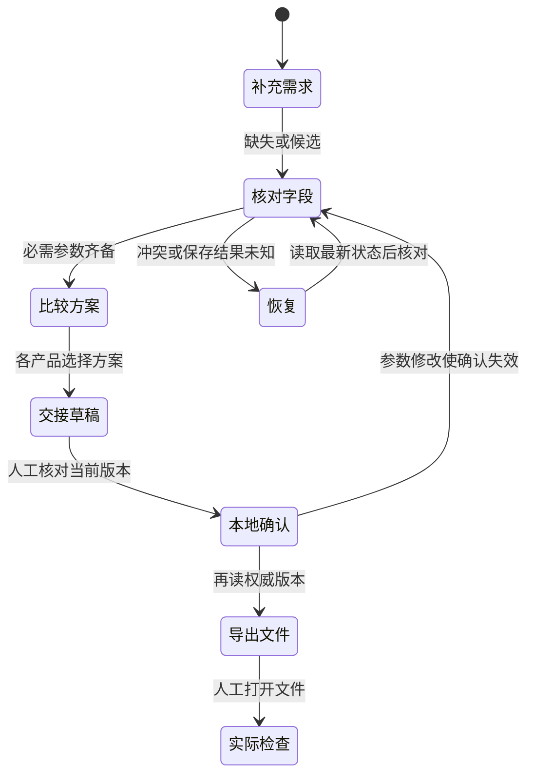

# 工作台组件与状态清单

适用：2026-10-15 未发布工作区。状态由后端订单与 review 投影判定，前端负责定位、解释、输入草稿和视图。交付证据见 [NEXT_STAGE_ACCEPTANCE](NEXT_STAGE_ACCEPTANCE.md)。

## 流程与边界

导出没有“供应商已接收”状态转换。实际打开文件并独立复核属于走查记录，不能由下载按钮代填。

## 组件状态矩阵

| 组件 | 正常 / 空状态 | 加载 / 失败 / 失效 | 只读与恢复 | 主要验证 |
| --- | --- | --- | --- | --- |
| 首次输入 | 唯一对话输入框，无静态三选项；右栏默认关闭 | 初始化完成前禁输入，失败保留持续恢复卡 | 草稿按订单保留；初始化不覆盖新输入 | 初始化延迟/失败、草稿和 IME 回归 |
| 订单检查器页脚 | 按当前状态提供一个下一步入口 | 阻断项可定位；生成/确认可用性由后端状态计算 | 归档给出查看动作；保存中禁重复提交 | review API、最后字段补齐与归档切单回归 |
| 复核字段 | 未填写/已填写/待确认/已确认有文字 | 清空恢复阻断；未保存草稿保留，服务端值变化提示 | 归档禁改；保存后恢复字段焦点；撤销产生新版本 | 字段API、浏览器清空/候选/切页 |
| 字段依据 | 默认简短来源；展开原文与置信度 | 无证据写明尚无记录，不填假来源 | 可读不等于已确认 | 基础浏览器来源检查 |
| 产品作用域 | 聊天、文件、方案标明当前项 | 无目标先选择；旧响应不改变新视图 | 切换不新增聊天、不推进业务revision | 2/3产品与乱序响应用例 |
| 方案比较 | 同一产品、数量、尺寸；差异表与独立选择按钮 | 无方案提示生成；未知价格不生成完整区间 | Enter/Space展开理由不选方案 | 价格状态与键盘用例 |
| 估算 | ready完整示例范围，明细/版本可查 | partial已知小计；blocked原因；stale历史明确 | 按订单+产品隔离；修改后不作为当前价格 | ready/partial/blocked/stale与切项回归 |
| 文件 | 文件待交付，或文件名/检查记录/范围 | 刷新读取实际记录；尺寸变更标需重查 | 延迟读取仍绑定原项；未选项不读取文件 | 文件刷新、失效和竞态用例 |
| 保存状态 | SQLite本机保存；memory仅进程 | 处理中、已回执、结果未知分别表达 | 每个订单分别保留未知操作；禁止盲目重发 | 丢回执/操作去重/跨单恢复 |
| 持续错误卡 | 校验/409/401/408/5xx有独立文案 | 展开错误码与请求号；不显示凭据 | 先读最新；已拒绝修改可显式重用；候选确认/拒绝必须重新核对 | 409候选变化/清空差异/凭据更新 |
| 交接单 | 草稿、本地确认、版本与未发送明确 | 必需字段或候选阻断；修改后旧确认失效 | 导出再读权威版本；备份与交接分开 | 下载JSON/MD逐项核对；A4打印 |
| 栏位与阅读 | 左历史、中央对话、右检查器；比较/交接可展开返回 | 窄屏左右抽屉互斥，背景 inert、焦点循环、Escape 关闭恢复 | 偏好宽度独立于临时约束；拖动不改订单 | 容器缩放、pointer 生命周期、方向键、草稿、慢回包回归 |

## 视觉约定

- 保留暖纸、深墨与品牌红；间距、字体、边框和状态色集中在 `styles.css` 令牌。
- 缺失、候选、错误、已确认等均有状态文字。信息度只说明字段进展，不能表示生产许可。
- 控件高度分两档：桌面端（>1050px）按钮刻意做扁（纵向内边距约 0.3em，渲染高约 22–26px）以利用纵向空间；≤1050px（指针/触屏布局）在 styles.css 末尾的触控基线块统一恢复高频输入、导航、确认、上传与主动作的 44px 最小目标（含快捷建议、聊天输入框与各摘要行）。小屏顶部使用两行布局保留触控空间。
- 面板分隔条画为居中单条 1px 细线（hover/拖动/聚焦时变主题红），命中宽度保持 `--splitter-w` 不变。
- 明显键盘焦点；深色顶栏使用浅色焦点框。屏幕阅读器只播报短任务状态，不重播整段对话。
- 打印使用白底黑字、A4、15mm页边距、产品分组、可重复表头和页码；不打印工作台控件。

核心正常主题令牌抽检：正文11.94:1，深纸底辅助/次要文字4.79:1，主按钮文字5.60:1，输入边框4.41:1，深色顶栏控件边框3.31:1，绿色/候选状态文字4.85/4.79:1；计算记录位于 `reports/next-stage-acceptance/contrast-token-samples.json`。此抽检不覆盖所有实际混合背景、悬停和禁用状态。

当前材料是组件实现与状态覆盖清单，并非全面 WCAG 合规声明。实际 200% 浏览器缩放、屏幕阅读器、手机系统键盘、真实触控与所有文字/控件组合的对比度需单独执行。640px重排测试只验证相应布局宽度。下一轮按 [USER_WALKTHROUGH](USER_WALKTHROUGH.md) 的 S08 记录设备与实际结果。

## 2026-10-24 补记（1.3.0 候选）：草稿焦点保持、引导绑定断言与错误文案单一来源

| 变更 | 状态语义 | 验证 |
| --- | --- | --- |
| 订单草稿字段重绘（TD-11） | 快照到达时正在编辑的输入框不再丢焦点与选区；`data-field-key`（`order:<fieldPath>` / `item:<itemId>:<fieldPath>`）跨重绘稳定；多产品产品项与编辑器的展开状态在同一订单的重绘间保留 | ui_focus 新增延迟响应用例；journey/ui_positions 全量回归 |
| 引导绑定断言（TD-06） | app.js 绑定段引用的全部元素 ID 在接线前一次性检查：缺失项以一条 `console.error` 汇总并在页面顶部显示 `.binding-banner` 横幅（role="alert"），仅跳过缺失元素的绑定，其余照常生效；不再被第一个 TypeError 静默吞掉后续全部绑定 | 页面完整时横幅不出现、无 console 输出；全部套件在完整页面上回归通过 |
| 错误文案单一来源（TD-19） | 用户可见失败文案收敛到 `PrintOpsJourney.ERROR_TEXTS`（code/状态桶 → `{title, hint}`）：持续错误卡标题沿用 409/401/403/408/5xx/4xx/断连桶文案，`ADDRESS_VALIDATION_TIMEOUT` 与设置页两条专案文案（"URL 和模型名需要同时填写"、"该接口解析到本机或内网地址…"）改由查表提供；未知 code 回落服务端消息与原有兜底，已有文案一字未变 | journey 错误恢复用例（409 候选变化、清空差异、凭据更新）全量通过 |

## 2026-10-25 补记（等待体验）：聊天可停止等待

| 变更 | 状态语义 | 验证 |
| --- | --- | --- |
| 停止等待按钮（`#chat-cancel`） | 仅在聊天回合等待中显示（`busy && isSending`，字段保存/视图加载等短暂 busy 不出现），空闲态保持 hidden 不影响布局。语义是"停止等待"而非取消服务端工作：点击后 pending 气泡移除、输入框恢复并聚焦；fetch 不 abort，服务端按会话锁照常完成并提交，迟到的响应正常渲染（回复进对话流、本地 revision 追平），且不抢占用户已移走的焦点、错误路径不回写用户已重写的输入框草稿 | journey_edges 新增停止等待用例（恢复、迟到渲染、下一轮 revision 追平无 409） |
| 停止后的下一条消息 | 若上一轮尚未落地，发送先等待其完成（发送键禁用 + "正在等待上一条回复完成…"提示），落地后再携带新 revision 发送；等待跨越切单/重置时排队文本不发往新会话 | 同上；journey/ui_positions/ui_focus/browser_smoke 全量回归 |
| purge 清理对齐 | 永久删除当前订单的 teardown 对齐重置对话框序列（补 sequence bump、pending 移除、busy 释放），修复 thinking 动画 interval 在游离节点上继续计时的泄漏 | journey 历史用例回归 |

## 2026-10-25 补记（视图与焦点）：面板静态化、空态引导与 P0-2

| 变更 | 状态语义 | 验证 |
| --- | --- | --- |
| 比较/交接面板静态声明 | 估算/推荐面板与生成/确认/导出动作直接写在比较/交接 pane 内，删除 `journey.init()` 的运行时搬移；HTML 源位置即运行时位置，打印与 DOM 检视所见一致 | journey/ui_positions 全量回归（方案卡片、交接动作、打印规则选择器全部继续命中） |
| 比较页空态 | 无品类：说明用途优先并给"回对话补充"入口；有品类无方案：提示可直接生成本项方案；查看入口任何状态可导航、不自动生成 | journey compare 空态与既有方案用例回归 |
| P0-2 焦点路由 | 遮罩/抽屉收起按"原焦点属主"回收到可见入口；跨断点或桌面折叠隐藏焦点所在栏位时路由到对应可见开关；焦点已在 `<body>` 且有原生 dialog 时让位；主动 blur 不复活。跨断点路径存在时序竞态：Chromium 可能把媒体查询样式重算排在 resize/media-change 事件之后，同步恢复在事件回调里看到焦点元素未失焦、面板未隐藏而跳过，布局落地后焦点滞留 `<body>`；`syncPaneViewport` 末尾追加双 rAF 延迟复查补一次路由（守卫条件与同步路径相同，幂等） | ui_focus 新增 2 项（断点路由、遮罩恢复），既有 15 项与 Chromium 全套件回归；竞态修复后断点路由用例 10 次重复、插桩复刻 16 次重复全部通过（修复前约 1/4 概率复现）；WebKit ui_focus 14/17（3 项为本机视口/媒体查询既有怪癖，基线复现一致，非焦点逻辑回归） |

## 2026-10-25 补记（重构收敛）：确认按钮、状态文案与 CSV 序列化

纯重构，零用户可见变化；状态语义不变，仅收敛重复实现。

| 变更 | 状态语义 | 验证 |
| --- | --- | --- |
| `needsConfirmation` + `confirmFieldButton` | 4 处"确认此值"按钮块统一为一个辅助函数；多产品编辑器仅按 review 状态（无置信度检查）的条件差异有意保留并注释 | journey 确认/候选用例、ui_focus 焦点保持全量回归 |
| 状态文案常量归置 | 订单/询价/估算/导出 4 个状态域的映射提升为模块级常量；导出审计与复核界面两套措辞保持分离（测试钉死） | journey 报价状态、历史状态与 CSV 审计用例回归 |
| `handoffCsvDocument(document)` | 交接 CSV 序列化为纯函数（表头/标签/转义逐字保留），下载机制留在 exportOrder | journey_edges "csv audit" 5 例真实下载逐项核对通过 |

## 2026-10-25 补记（视觉密度与常用规格）：细分隔条、控件做扁与保存复用

| 变更 | 状态语义 | 验证 |
| --- | --- | --- |
| 分隔条 1px 细线 | `.pane-splitter` 由双边框 + 中央 34px 把手改为透明底 + 居中 1px 线（hover/拖动/聚焦变主题红）；命中宽度仍为 `--splitter-w`，拖拽与键盘语义不变 | ui_positions 拖动/命中用例全量回归 |
| 控件做扁 + 触控基线归置 | 桌面端 ~10 类按钮纵向内边距统一 0.3em（渲染高约 22–26px），设置入口紧凑块 36→28px；散落的桌面 44px 最小高度删除，统一收进 `@media (max-width: 1050px)` 触控基线块。移动端实测（390px）补齐两处既有缺口：快捷建议按钮约 24→44px、聊天输入框 38→44px | 临时测量脚本实测：390px 下快捷建议/上传/发送/聊天输入框均 ≥44px，1440px 下对应控件 22–38px 保持扁平；四套 Chromium 套件全量复跑通过 |
| 常用规格保存上移标题行 | 删除沉底通栏保存按钮，标题行改为「常用规格 · N 组 · ＋ 保存」；保存后新条目高亮闪烁（field-flash）并滚动到可见位置，toast 引导"点击列表中的组合即可复用"；点击列表条目即复用（applySpecPreset → sendMessage 补丁）不变 | journey 常用规格用例回归；交互路径无新增状态 |
| 历史订单区做扁 | 桌面端订单卡片取消 58px 最小高度、纵向内边距 10→5px（单行标题卡片实测 58→31px）；右键菜单项 44px→约 0.3em 内边距（实测 44→23px）并纳入 ≤1050px 触控基线。移动端卡片保持 60px、菜单项 44px、悬停快捷钮 44×40（触屏常显）不变 | 临时测量脚本实测两档高度；journey 历史切换/右键菜单/悬停动作用例与四套件全量回归 |

## 2026-10-25 补记（归档管理）：设置面板归档列表与概览瘦身

| 变更 | 状态语义 | 验证 |
| --- | --- | --- |
| 设置 → 历史归档管理列表 | "显示已归档订单"开关下方列出归档订单（标题 + 归档时间），每行 查看（关闭设置并切单）/ 导出（完整备份）/ 永久删除（红色 danger，confirm 确认不变）；面板切到 history 视图时刷新（`/api/orders?includeArchived=true&status=archived`），空列表显示引导空态（指向左栏右键"归档订单"）；行按钮纳入 ≤1050px 触控基线（44px） | journey_edges 新增用例：归档 → 设置面板列表可见 → 永久删除 → 空态出现 → API 复核无残留；用例开头清空 worker 级共享库的前序归档残留，行按 sessionId 定位避免同名订单歧义 |
| 历史动作双缓存查找（`findOrderEntry`） | 导出/归档/永久删除的 revision 与 status 查找从仅侧栏缓存扩展为侧栏 + 设置面板缓存双查：侧栏隐藏归档单（开关关闭）时，从设置面板发起的动作不再被"找不到条目"拦住 | 同上（侧栏默认隐藏归档单时设置面板直接永久删除成功） |
| 订单概览移除"目标平台"行 | `overviewFields` 6→5（productType/quantity/purpose/deadline/budget），进度分母自动更新，CSV 订单概览段自动同步；该行此前长期显示"通用印刷平台 · 未配置"占位噪音。供应商接口区的 `#platform-select` 保留（平台切换流程与 browser_smoke 用例依赖） | browser_smoke 平台切换用例回归；设置归档面板截图人工核验（概览 2/5 分母） |
| 历史悬停快捷钮做扁 | 31px 单行卡片右侧的查看/导出/归档悬停钮由 30×30 方块改为透明底文字钮（min-width 26px，实测高 21px），完整落在卡片内不再溢出；触屏端常显态仍恢复 44px 触控目标 | 临时测量脚本实测卡片 31px/悬停钮 21px；journey 悬停动作用例与四套件全量回归 |

## 2026-10-25 补记（批量管理）：设置历史订单多选删除与常用规格抽屉

| 变更 | 状态语义 | 验证 |
| --- | --- | --- |
| 设置 → 历史订单全量管理列表 | 面板列出全部订单（进行中+已归档，limit 100），行 = 复选框 + 查看（归档行带「已归档 ·」前缀、标题置灰）+ 导出 + 归档（进行中）/ 永久删除（恒有）；工具条常驻：全选（半选态）+ 已选 N + 归档所选/导出所选/删除所选，选择为 0 时禁用；「显示已归档订单」开关移至列表下方，语义不变仅控侧栏浏览；选择集合在刷新时剪枝消失条目 | journey_edges 重写用例（断言全部按 sessionId 作用域，worker 级共享库不再影响）；截图人工核验工具条/复选行/红色删除钮 |
| 批量操作一次确认 | 归档/导出/删除所选各弹一次 confirm 后逐单串行执行；删除走 purgeOrderEntry（未归档先 archive、用响应新 revision 链 purge），单条 409 失败跳过并 toast 汇总；选中含当前会话时批量收尾统一 teardown 一次 | journey_edges 新增用例：两单勾选 → 已选 2 → 一次 dialog → 两行归零 + API 复核均无 + 侧栏条目消失 + 恰好 1 次 confirm |
| 永久删除统一链 | historyAction purge 分支不再静默拒绝未归档订单：confirm 文案区分状态（明示"先自动归档再清除"），purgeOrderEntry 与批量共用；teardownIfCurrentOrder 提取当前会话清理序列供单删/批量复用；侧栏右键菜单进行中订单新增「永久删除」（排归档之后，键盘用例 ArrowDown 聚焦不变）。悬停快捷钮维持两钮——历史行仅约 160px 宽，第三个悬停钮浮层会盖住行中心点吞掉整行点击（实测 elementFromPoint 复现），故侧栏一键删除只走右键菜单 | journey 38 全量回归（含 smoke 菜单计数/聚焦钉死项）；hover 拦截问题以几何探针用例复现后修复 |
| 常用规格沉底底栏 | 侧栏改三行 grid（品牌/滚动区/底栏），preset 面板钉死在最底边（收起约 30px：小号「＋ 保存常用」+ 放大主控「常用 N ▾」），不随历史列表滚动；点「常用」在左栏内部展开（底栏随内容增高、上方滚动区等量收窄，max-height min(300px,45vh) 内滚，无浮层），条目点击沿用 sendMessage("沿用常用规格", patch) 复用并收起，× 删除；保存后自动展开 + is-new 闪亮（field-flash 沿用）；外点/Escape 收起并归还焦点到 #preset-toggle（aria-expanded 同步）；与右键菜单互斥；存储键与 8 条上限不变 | journey_edges preset 用例：贴底不随滚动断言（scrollTop 前后 bottom 不变）、展开仍在侧栏内的断言、保存自动开+闪亮 → 应用发 /api/chat 且收起 → 重开删除归零 + 空态 → Escape 收起；几何探针实测收起 gap=0、展开 drawerInside=true 且滚动区收窄；截图人工核验按钮大小对比 |
