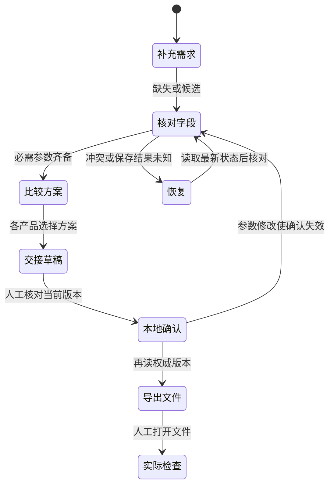

# 工作台组件与状态清单

适用：2026-10-15 未发布工作区。状态由后端订单与 review 投影判定，前端负责定位、解释、输入草稿和视图。交付证据见 [NEXT_STAGE_ACCEPTANCE](NEXT_STAGE_ACCEPTANCE.md)。

## 流程与边界

导出没有“供应商已接收”状态转换。实际打开文件并独立复核属于走查记录，不能由下载按钮代填。

## 组件状态矩阵

| 组件 | 正常 / 空状态 | 加载 / 失败 / 失效 | 只读与恢复 | 主要验证 |
| --- | --- | --- | --- | --- |
| 首次输入 | 唯一对话输入框，无静态三选项；右栏默认关闭 | 初始化完成前禁输入，失败保留持续恢复卡 | 草稿按订单保留；初始化不覆盖新输入 | 初始化延迟/失败、草稿和 IME 回归 |
| 订单检查器页脚 | 按当前状态提供一个下一步入口 | 阻断项可定位；生成/确认可用性由后端状态计算 | 归档给出查看动作；保存中禁重复提交 | review API、最后字段补齐与归档切单回归 |
| 复核字段 | 未填写/已填写/待确认/已确认有文字 | 清空恢复阻断；未保存草稿保留，服务端值变化提示 | 归档禁改；保存后恢复字段焦点；撤销产生新版本 | 字段API、浏览器清空/候选/切页 |
| 字段依据 | 默认简短来源；展开原文与置信度 | 无证据写明尚无记录，不填假来源 | 可读不等于已确认 | 基础浏览器来源检查 |
| 产品作用域 | 聊天、文件、方案标明当前项 | 无目标先选择；旧响应不改变新视图 | 切换不新增聊天、不推进业务revision | 2/3产品与乱序响应用例 |
| 方案比较 | 同一产品、数量、尺寸；差异表与独立选择按钮 | 无方案提示生成；未知价格不生成完整区间 | Enter/Space展开理由不选方案 | 价格状态与键盘用例 |
| 估算 | ready完整示例范围，明细/版本可查 | partial已知小计；blocked原因；stale历史明确 | 按订单+产品隔离；修改后不作为当前价格 | ready/partial/blocked/stale与切项回归 |
| 文件 | 文件待交付，或文件名/检查记录/范围 | 刷新读取实际记录；尺寸变更标需重查 | 延迟读取仍绑定原项；未选项不读取文件 | 文件刷新、失效和竞态用例 |
| 保存状态 | SQLite本机保存；memory仅进程 | 处理中、已回执、结果未知分别表达 | 每个订单分别保留未知操作；禁止盲目重发 | 丢回执/操作去重/跨单恢复 |
| 持续错误卡 | 校验/409/401/408/5xx有独立文案 | 展开错误码与请求号；不显示凭据 | 先读最新；已拒绝修改可显式重用；候选确认/拒绝必须重新核对 | 409候选变化/清空差异/凭据更新 |
| 交接单 | 草稿、本地确认、版本与未发送明确 | 必需字段或候选阻断；修改后旧确认失效 | 导出再读权威版本；备份与交接分开 | 下载JSON/MD逐项核对；A4打印 |
| 栏位与阅读 | 左历史、中央对话、右检查器；比较/交接可展开返回 | 窄屏左右抽屉互斥，背景 inert、焦点循环、Escape 关闭恢复 | 偏好宽度独立于临时约束；拖动不改订单 | 容器缩放、pointer 生命周期、方向键、草稿、慢回包回归 |

## 视觉约定

- 保留暖纸、深墨与品牌红；间距、字体、边框和状态色集中在 `styles.css` 令牌。
- 缺失、候选、错误、已确认等均有状态文字。信息度只说明字段进展，不能表示生产许可。
- 高频输入、导航、确认、上传与主动作以至少 44px 高度为基线；小屏顶部使用两行布局保留触控空间。
- 明显键盘焦点；深色顶栏使用浅色焦点框。屏幕阅读器只播报短任务状态，不重播整段对话。
- 打印使用白底黑字、A4、15mm页边距、产品分组、可重复表头和页码；不打印工作台控件。

核心正常主题令牌抽检：正文11.94:1，深纸底辅助/次要文字4.79:1，主按钮文字5.60:1，输入边框4.41:1，深色顶栏控件边框3.31:1，绿色/候选状态文字4.85/4.79:1；计算记录位于 `reports/next-stage-acceptance/contrast-token-samples.json`。此抽检不覆盖所有实际混合背景、悬停和禁用状态。

当前材料是组件实现与状态覆盖清单，并非全面 WCAG 合规声明。实际 200% 浏览器缩放、屏幕阅读器、手机系统键盘、真实触控与所有文字/控件组合的对比度需单独执行。640px重排测试只验证相应布局宽度。下一轮按 [USER_WALKTHROUGH](USER_WALKTHROUGH.md) 的 S08 记录设备与实际结果。
